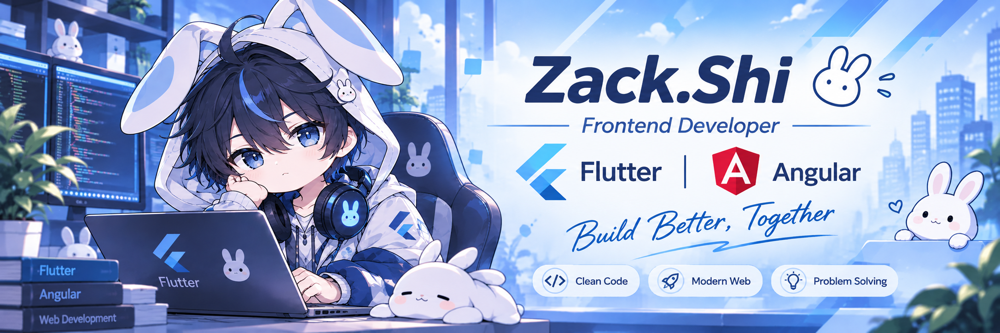

  

<h1 align="center">Hi, I'm Zack 👋</h1>

  <b>Flutter / Frontend Engineer • AI-Native Engineering • Developer Tooling</b>

---

## 👨‍💻 About Me

Flutter / Frontend Engineer focused on scalable cross-platform and web applications using Flutter, Dart, Angular, and Next.js.

Experienced in enterprise-scale commerce systems, frontend architecture, Flutter migration projects, and developer productivity tooling. I enjoy building maintainable systems and designing architectures and conventions that let AI agents produce consistent, high-quality code.

I pursue AI-native development: treating AI agents as first-class collaborators across the whole development lifecycle, and exploring agent orchestration, agent skills, and terminal-based tooling.

---

## 🚀 Featured Projects

### [Flutter Agent Panel](https://github.com/Poorgramer-Zack/flutter-agent-panel)
Cross-platform AI-native workflow tool integrating terminal systems and AI agents across Windows, macOS, and Linux.

Focused on developer productivity, workflow orchestration, and AI-native tooling experiences.

### [dart-expert-skills](https://github.com/Poorgramer-Zack/dart-expert-skills)
Expert Dart skills that equip AI agents with deeper, more reliable knowledge of the Dart ecosystem.

---

## 🛠️ Tech Stack

### Frontend & Cross-Platform
Flutter, Dart, Angular, Next.js, Vue

### Backend
Serverpod, FastAPI

### Architecture & DevOps
Clean Architecture, CI/CD, Modularization, Docker

### AI-Native Engineering
Agentic Workflows, Agent  Orchestration, Developer Tools, Agent Skills

---

## 🧠 Engineering Principles

- Build scalable systems, not just features
- Optimize workflows through automation
- Design AI-native engineering experiences
- Prioritize maintainability and long-term engineering quality

---

## 📫 Connect

- 💼 LinkedIn: [Zack Shi](https://www.linkedin.com/in/poorgramerZack)
- 📧 Email: [pshakya8751@gmail.com](mailto:pshakya8751@gmail.com)